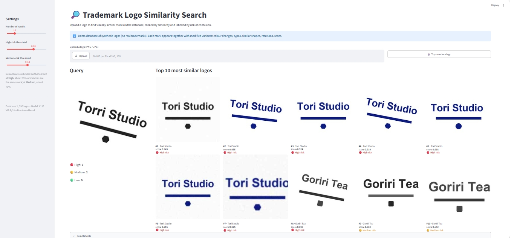
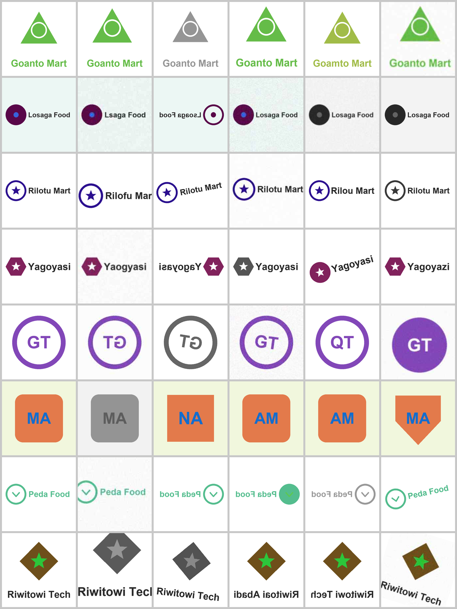
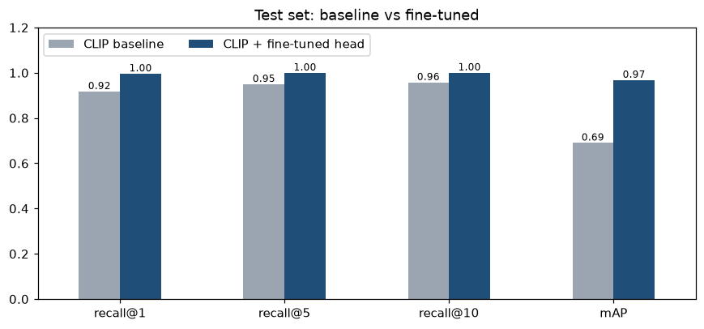
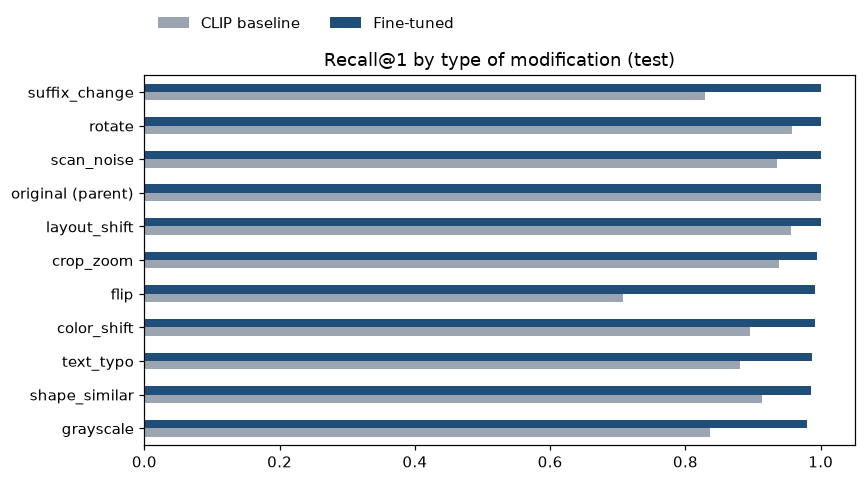

# 🔎 Trademark Logo Similarity Search

Visual search engine that finds **confusingly similar logos** for trademark clearance, built with
**CLIP + metric learning (triplet loss) + FAISS** and deployed as a Streamlit app.

**[▶ Live demo](https://YOUR-APP.streamlit.app)** <!-- TODO: replace with your Streamlit URL -->

 <!-- TODO: add a screenshot of the running app -->

---

## Business problem

Before a new trademark is filed, IP consultants must check whether the logo is confusingly
similar to marks that are already registered. Look-alike marks are rarely exact copies: the colour
changes, a letter changes, the device is slightly altered, or the image is a poor scan. Checking
thousands of logos by eye is slow and inconsistent.

**This project:** upload a logo and get a ranked short list of the most similar marks, each with a
similarity score and a **High / Medium / Low** risk label.

## Dataset

To get reliable ground truth (and avoid publishing third-party logos), the dataset is **synthetic**:
`src/generate_logos.py` creates 1,000 parent logos and 8 modified variants of each (**9,000 images**).
Variants combine 1–3 realistic modifications: colour shift, typo in the name, different descriptor,
similar shape, layout shift, rotation, mirroring, scan noise / JPEG artefacts, cropping and grayscale.
All images of the same parent are "the same mark". The train / val / test split (70/15/15) is done
**per mark**, so the model is always tested on marks it has never seen.


*First column: parent logo. Other columns: generated variants.*

## Approach

```
logo image ──► CLIP ViT-B/32 (frozen) ──► 512-d ──► projection head (trained) ──► 512-d ──► FAISS ──► top-K + risk
```

1. **Baseline:** pretrained CLIP image embeddings + cosine search with FAISS, no training.
2. **Fine-tuning:** a small residual MLP on top of frozen CLIP, trained with **batch-hard triplet loss**
   (P×K batch sampling). It is initialised as the identity, so training starts exactly at the baseline.
   It trains in minutes on a CPU and the weights are ~2 MB.
3. **Risk calibration:** similarity thresholds chosen on the score distributions of same-mark vs
   different-mark pairs (High ≈ 95% precision, Medium ≈ 70%).

## Results (test set: 150 unseen marks, 1,350 images)


| Metric | CLIP baseline | + Fine-tuned head |
|---|---|---|
| Recall@1 | 0.917 | **0.996** |
| Recall@5 | 0.949 | **0.999** |
| Recall@10 | 0.957 | **1.000** |
| mAP | 0.690 | **0.967** |



**Recall@1 by type of modification:** which changes are hardest to see through.



### Key insights

- **mAP +27.8 points (0.690 → 0.967):** almost all variants of a mark are now ranked at the top, not just one, which is what a clearance search needs.
- **Mirrored logos** were the baseline's main blind spot: reversed text made CLIP match *other* mirrored marks. Fine-tuning fixed it (Recall@1 for `flip`: 0.708 → 0.992).
- **Grayscale combined with a shape change** is the hardest remaining case. Some of these "errors" are actually plausible conflicts (e.g. marks sharing the same initials).
- **Lightweight:** only a ~2 MB head is trained on top of frozen CLIP. It trains in minutes on a CPU and runs on a free Streamlit instance.

## Project structure

```
├── src/
│   ├── generate_logos.py      # synthetic dataset generator
│   ├── model.py               # CLIP loading, projection head, triplet loss, P×K sampler
│   ├── metrics.py             # Recall@K, mAP, threshold calibration
│   └── viz.py                 # plotting helpers
├── notebooks/
│   ├── 01_data_generation_eda.ipynb
│   ├── 02_baseline_clip_faiss.ipynb
│   ├── 03_finetune_triplet.ipynb
│   └── 04_evaluation_error_analysis.ipynb
├── models/projection_head.pt  # trained head (~2 MB)
├── results/                   # metrics, thresholds, training history
├── app/
│   ├── app.py                 # Streamlit app
│   ├── requirements.txt       # deployment dependencies (CPU-only torch)
│   └── gallery/               # search database: test logos + FAISS index
└── assets/                    # figures used in this README
```

## How to run

```bash
git clone https://github.com/brmsyh/trademark-logo-similarity.git
cd trademark-logo-similarity
python -m venv .venv
source .venv/bin/activate        # Windows: .venv\Scripts\activate
pip install -r requirements.txt
```

Run the notebooks in order (01 → 04). Notebook 01 generates the dataset into `data/`.
Then start the app:

```bash
streamlit run app/app.py
```

## Limitations & next steps

- Scores are high partly because synthetic variants are cleaner than real-world look-alikes; expect lower numbers on real trademark data.
- Trained on synthetic logos. For production, fine-tune on real labelled pairs (e.g. opposition
  decisions where marks were found confusingly similar).
- Visual similarity only: combine with a text / phonetic similarity model for word marks.
- Add Nice class filtering so only marks in relevant classes are compared.
- For millions of logos, switch to an approximate FAISS index (IVF / HNSW).

## Tech stack

Python · PyTorch · OpenCLIP · FAISS · NumPy · pandas · Matplotlib · Pillow · Streamlit
